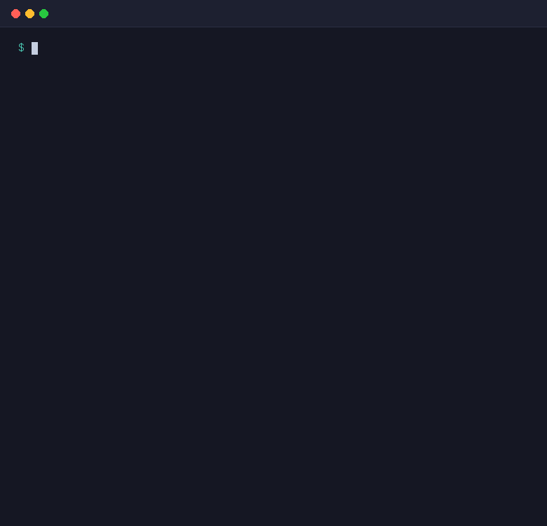

# Fichas de feature

Entre la documentación de `docs/` (que describe el proyecto entero) y el código hay un hueco: la
unidad de trabajo. Una feature es lo que se acuerda, se construye y se da por terminado de una vez.
Su ficha es el contrato: **qué se construye, cómo se comporta, en qué orden se construye, cómo se
sabrá que funciona y qué queda fuera**, escrito antes de empezar y no reconstruido después a partir
del diff.

La ficha no sustituye a `docs/`. El PRD dice *qué* quiere el producto y *por qué*; la ficha dice
*cómo* debe funcionar un trozo concreto (su spec), *en qué orden* se construye (su plan) y con qué
se demuestra. Cuando la feature termina, lo que aprendimos
sube a `docs/` y la ficha se queda como registro de la decisión.

Esta carpeta **empieza vacía a propósito**: solo con este archivo, que explica el formato.

---

## Cuándo crear una ficha

Cuando el trabajo cumpla alguna de estas condiciones:

- Cierra uno o más requisitos del PRD (`M-01`, `S-02`…).
- Toca más de tres o cuatro archivos, o cruza capas (UI + datos, o app + integración externa).
- Va a ocupar más de una sesión de trabajo.

Para un arreglo puntual, un cambio de copy o un ajuste de estilos, no hace falta ficha: basta la
entrada de changelog cuando esté hecho. La ficha existe para que no se pierda el *acuerdo previo*,
y en un cambio pequeño no hay acuerdo previo que perder.

Crea la ficha con `/feature`. Un archivo por feature: `docs/features/nombre-en-kebab-case.md`.

---

## Formato

```markdown
# [Nombre de la feature]

**Estado:** Acordada · En construcción · Verificada
**Requisitos que cierra:** M-01, M-03
**Fecha de acuerdo:** YYYY-MM-DD

## Qué se construye

Dos o tres párrafos. Qué verá o podrá hacer el usuario cuando esto exista.
Sin detalle de implementación: eso va en la tabla de cobertura y en el código.

## Comportamiento

Solo lo que el agente decidiría distinto de como lo quieres si no estuviera escrito.
Un apartado que no aplique se borra; si el flujo ya está en `docs/user-flows.md`,
enlaza su `FLOW-xx` en vez de repetirlo.

- **Estados:** qué ve el usuario en cada uno (vacío, cargando, listo, error) y qué
  lo hace pasar de uno a otro.
- **Cuando algo falla:** qué se le dice, qué se conserva de lo que ya había hecho y
  cómo sigue.
- **Casos límite:** datos vacíos, repetidos o enormes; doble clic; sin conexión.
- **Datos y contratos:** qué crea, lee o expone esta feature (tabla, endpoint,
  evento). Si cambia el modelo de datos, va también a `docs/data-model.md`.
- **Si hay IA:** con qué conjunto de casos y qué umbral se evalúa, fijado antes de
  construir, y que se vuelve a pasar al cambiar el modelo o el prompt.

## Decisiones tomadas

Las que no se deducen del código y costaría volver a discutir. Una línea cada una,
con el motivo. Si alguna afecta a la arquitectura o al modelo de datos, además hay
que llevarla a `docs/` en la misma sesión.

## Cobertura

| Requisito | Se implementa en | Se valida con |
|-----------|------------------|---------------|
| M-01 | `src/app/(auth)/registro/` | `tests/registro.spec.ts` |
| M-02 | `src/components/chat/` | revisión humana: el chat en la vista previa a tamaño móvil; se lee sin desplazar en horizontal |
| M-03 | migración `002_indices` | no verificable por interfaz: índice de BD, se comprueba con `EXPLAIN` antes del PR |

## Plan

Los pasos en el orden en que se construyen. Cada paso cubre una o más filas de la
tabla y termina en algo que se puede revisar.

1. **M-03** — Índices y migración reversible. *Revisable:* `EXPLAIN` usa el índice.
   *Se deshace con:* la migración de bajada.
2. **M-01** — Registro con email (depende de 1). *Revisable:* en local, el registro
   llega al dashboard vacío.
3. **M-02** — Chat (depende de 2). *Revisable:* la vista previa a tamaño móvil.

**Riesgos:** lo que puede torcer el plan y qué se hace si pasa. Una línea cada uno.

## Fuera de esta feature

Lo que se ha hablado y se ha decidido NO hacer aquí, para que no vuelva a discutirse
a mitad de camino. Si algo de aquí merece existir algún día, va a `mejoras/`.
```

---

## La tabla de cobertura es la parte que importa

Todo lo demás de la ficha es contexto. La tabla es el contrato, y tiene una sola regla:

> **Ningún requisito se queda sin una tercera columna rellena.**

Hay exactamente tres formas válidas de rellenarla:

- **La ruta del test que lo valida.** No hace falta que el test exista todavía cuando se escribe la
  ficha — se escribe después de implementar (ver `docs/testing.md`). Lo que se declara aquí es el
  compromiso de que existirá.
- **`revisión humana: <qué se mira>; <qué tiene que verse>`.** Hay requisitos que se comprueban
  mejor con los ojos que con un test: que el chat se lea en el móvil, que una conversación concreta
  fluya como se acordó, que una pantalla se vea como dice el design system. Es tan válida como un
  test con una condición: **dice qué se mira y qué tiene que verse**, de forma que otra persona
  pueda repetirla y llegar a la misma conclusión. "Lo he mirado y está bien" no es una revisión.
  Se hace en la pasada de validación, en local, y el PR dice que se hizo y qué se vio.
- **`no verificable por interfaz: <razón concreta>` + cómo se comprueba entonces.** Para lo que no
  tiene interfaz que mirar ni test que lo cubra: un índice de base de datos, una variable de
  entorno. La razón se escribe, y se escribe concreta. "No aplica" no es una razón. "No me dio
  tiempo" tampoco: eso es un test pendiente, no una excepción.

El motivo de tanta insistencia: lo que se queda sin validar rara vez se decide, se *escurre*. Nadie
dice "este requisito no lo vamos a comprobar"; simplemente no aparece en ningún sitio y nadie lo
echa de menos hasta que falla en producción. Obligar a escribir la excepción convierte una omisión
invisible en una frase que alguien puede leer y discutir.

**Y esta regla se comprueba sola.** `scripts/verificar-cobertura.mjs` valida las tablas contra
`docs/prd.md` y se ejecuta en CI con cada pull request:

```bash
node scripts/verificar-cobertura.mjs
```

Detecta filas sin tercera columna, excepciones vacías de contenido ("no aplica" no cuela),
revisiones humanas que no dicen qué se mira y qué tiene que verse, identificadores que no existen
en el PRD, y —lo más útil— **tests declarados que nunca se
escribieron**, cuando la ficha ya dice estar Verificada. Mientras está *Acordada* o *En
construcción* no exige que los archivos existan: los tests van después de implementar, y hacerlo
fallar antes solo enseñaría a ignorar los rojos.

Lo que verifica es **estructural, no semántico**: detecta el test que se prometió y no se escribió,
no el test que no comprueba nada. Un archivo vacío pasaría la verificación, y una revisión humana
bien escrita pasaría aunque nadie la hubiera hecho: por eso el PR la declara. La diferencia es que un
archivo vacío **sí se ve en el diff del PR**, y un archivo inexistente no. El suelo sube; no
desaparece el criterio.

Corre también en CI con cada pull request, y eso no es redundancia: quien rellena la tabla es quien
tendría que cumplirla, así que la comprobación vive donde no se pueda saltar. Si falla en CI, se
arregla la causa — no se toca el workflow.

Una fila puede declarar varios tests separándolos por comas.

<p align="center">
  
</p>

---

## Comportamiento y plan: lo justo

Las dos secciones existen por lo mismo: **una decisión que no está escrita la toma el agente, y la
toma dentro del código**, donde nadie la revisa. "Comportamiento" cubre lo que pasa cuando las
cosas no van bien, que es lo que los criterios de aceptación del PRD suelen dejar fuera. "Plan"
cubre el orden, que sin escribir se decide sobre la marcha.

No son para rellenar por rellenar. Una ficha de una sola fila tiene un plan de un paso, y basta una
línea. Un comportamiento detallado sobre algo que da igual cómo salga es ruido. La pregunta para
cada línea es: *si no la escribo, ¿podría el agente hacer algo que no quiero?* Si la respuesta es
no, sobra.

Tres reglas del plan:

- **Cada paso termina en un estado revisable y en un commit.** Es lo que te deja comprobar un trozo
  antes de que se construya otro encima, y volver atrás si hace falta.
- **Lo que toca datos o servicios externos dice cómo se deshace.** Los checkpoints del agente
  deshacen ediciones de archivos, no una migración aplicada ni un registro creado en un servicio
  externo. Migraciones reversibles, y la vuelta atrás escrita en el paso.
- **El plan decide cómo, no qué.** Puede elegir el orden, partir un requisito en dos pasos o
  resolver detalles de implementación. Si aparece un requisito nuevo, no entra en el plan en
  silencio: primero va al PRD, con su ID y su criterio, y después a la tabla.

---

## Estado de la ficha

Tres valores, y se actualizan en el momento, no al final:

| Estado | Significa |
|--------|-----------|
| **Acordada** | La ficha está escrita, revisada en busca de ambigüedades y validada con el usuario. No hay código todavía |
| **En construcción** | Se está implementando, un paso del plan cada vez. La tabla de cobertura y el plan ya no cambian sin avisar |
| **Verificada** | Todos los requisitos de la tabla tienen su validación hecha y pasando |

Sirve para retomar. Una sesión nueva que abra esta carpeta sabe en dos segundos qué hay a medias y
por dónde seguir, sin releer el repo entero ni fiarse de la memoria de la conversación anterior.

---

Este archivo es la única excepción de la carpeta: no es una ficha, es la explicación del formato.
Consérvalo mientras la carpeta tenga sentido para el equipo.
